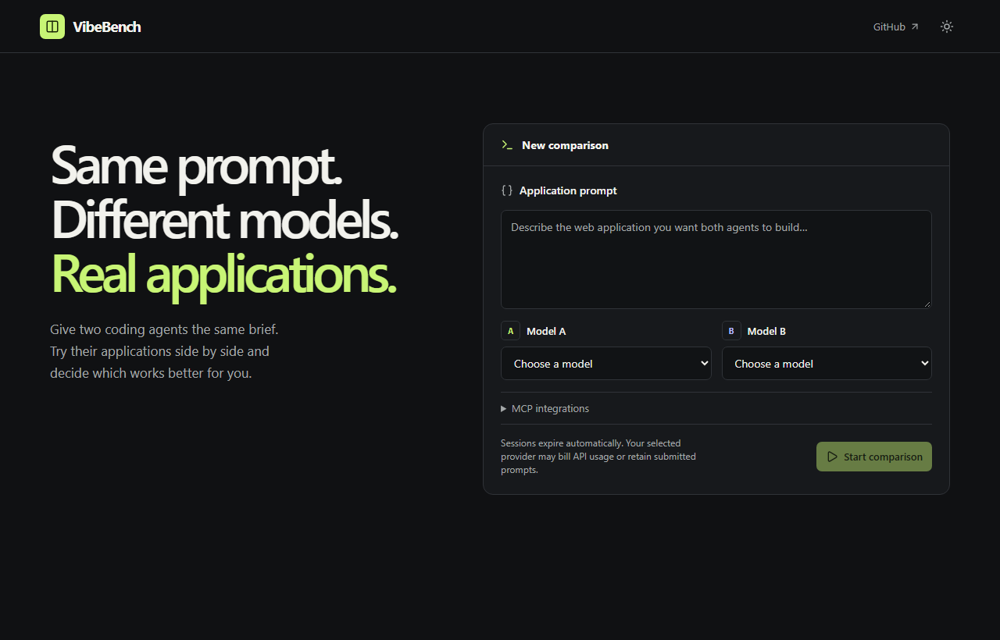

# VibeBench

**Same prompt. Different models. Real applications.**

VibeBench is an open-source playground for comparing coding agents through the web applications they generate. Give two OpenCode agents the same prompt, inspect live activity, interact with both previews, and download either workspace as a ZIP. Sessions and their workspaces expire automatically.



## Run locally

Install Docker Engine with Compose or start Docker Desktop with Linux containers enabled. Chromium-based browsers resolve the individual `*.localhost` preview addresses to loopback.

On Linux or macOS:

```sh
secret=$(openssl rand -hex 32)
sed "s/^VB_GATEWAY_SECRET=$/VB_GATEWAY_SECRET=$secret/" .env.example > .env
docker compose --profile build build sandbox-image
docker compose up --build -d --wait
```

On Windows PowerShell 7:

```powershell
$secret = [Convert]::ToHexString([System.Security.Cryptography.RandomNumberGenerator]::GetBytes(32))
(Get-Content .env.example) -replace '^VB_GATEWAY_SECRET=$', "VB_GATEWAY_SECRET=$secret" | Set-Content .env
docker compose --profile build build sandbox-image
docker compose up --build -d --wait
```

Open `http://localhost:8080`. Compose exposes only the Caddy gateway on loopback. Caddy fronts Next.js, FastAPI and isolated application previews. The backend starts two independent OpenCode servers via the Docker SDK. Each ephemeral sandbox has a separate internal bridge and HTTPS egress through an allowlisted CONNECT proxy. The main application requires no database, Redis, accounts or persistent project storage.

```sh
docker compose logs -f backend caddy egress
docker compose restart backend
docker compose down
```

Restarting FastAPI cleans orphaned resources in the configured Docker namespace and ends its active comparisons. Review `VB_MAX_SESSIONS`, `VB_IDLE_SECONDS`, `VB_LIFETIME_SECONDS`, and the sandbox resource limits in `.env.example`. Add approved HTTPS registry or CDN hostnames through `VB_EXTRA_EGRESS_HOSTS` as a space-separated list. OpenCode is pinned to 1.2.27 with checksum-verified release binaries.

## Models and MCP

The catalog intersects advertised zero-cost, tool-capable Models.dev entries with OpenCode Zen's current model discovery endpoint. OpenCode checks its own catalog inside each sandbox before sending a prompt. Free availability and quota can change. The interface reports exhaustion and keeps the selected model. Review provider terms and privacy before sending data. [OpenCode Zen](https://dev.opencode.ai/docs/zen)

BYOK supports fixed endpoints for OpenAI, Anthropic, Gemini, OpenRouter, DeepSeek and Groq. Enter keys through the model selector and enable key reuse when the two agents use the same provider. Raw provider keys stay in backend memory. A workspace receives a short-lived, model-scoped broker grant. Providers can bill the account for requested model usage. Arbitrary provider URLs are disabled.

Context7 uses a fixed remote MCP endpoint and may enforce upstream authentication or usage limits. Playwright, Figma, Blender and GitHub are listed in the registry as unavailable. Custom MCP servers require separate isolation and authorization.

## Development

Use Python 3.12+ with uv and Node.js 22 with pnpm. The API-only mode disables sandbox execution. Point Next.js to it with `VB_DEV_API=http://127.0.0.1:8000`.

```sh
cd backend
uv sync --locked
uv run uvicorn app.main:app --reload --port 8000 --no-access-log
```

```sh
cd frontend
pnpm install --frozen-lockfile
VB_DEV_API=http://127.0.0.1:8000 pnpm dev
```

```sh
# From backend/
uv run ruff check .
uv run ruff format --check .
uv run pytest

# From frontend/
pnpm lint
pnpm typecheck
pnpm build
pnpm exec playwright install chromium
pnpm test
```

Playwright defaults to the local Compose gateway and mocks its API for the UI test. Use `VB_DOCKER_SMOKE=1 pnpm test` for real Docker transport, isolation, previews and ZIP tests with fixture applications. Use `VB_REAL_SMOKE=1 pnpm test` for real model generation, with optional `VB_SMOKE_MODEL_A` and `VB_SMOKE_MODEL_B` values in `provider/model` format. Run the opt-in tests with one empty comparison slot and Turnstile disabled.

## Deployment

- [Architecture](docs/architecture.md)
- [Ubuntu ARM64, SSH, gVisor and Cloudflare](docs/deployment.md)
- [Threat model and security limitations](docs/security.md)
- [MCP integration details](docs/mcp.md)
- [Implementation status and roadmap](TASKS.md)

The Compose setup is local by default. Public mode remains gated while native gVisor isolation, Cloudflare and provider terms are being verified. The repository is MIT licensed.
